## Stack

| Layer | Technology | Role |
|---|---|---|
| Language / runtime | **.NET 10, C#** | Everything: core, CLI, app |
| Containment | **Microsoft Execution Containers (MXC)** | Runs the item in a deny-by-default process container and produces the activity report (from Phase 2) |
| Rules | **Deterministic rule engine** (`Preflight.Core`) | Turns events into findings and sets the verdict level and certainty |
| Local AI | **Foundry Local** (all PCs), **Windows AI APIs / Phi Silica** (Copilot+ PCs) | Explains and ranks findings in plain language; never decides alone |
| Fallback explainer | **Template explainer** | Deterministic sentences per rule; works with no model |
| Egress guard | Custom redaction (`Preflight.Guard`) | Strips user names, paths, secrets and personal data from anything outbound |
| Cloud (optional) | Hash reputation service, OpenAI-compatible model; keys in **Windows Credential Manager** | Second opinion |
| Storage | **SQLite** (`Microsoft.Data.Sqlite`) | Decision log |
| UI | CLI first, then **WinUI 3 / Windows App SDK**, MSIX | Drop zone, verdict card, evidence, Explorer context menu, notifications |
| Tests | **xUnit** | Rule, golden-fixture, guard and payload tests |

### Role of the local AI

The model is a **translator, not a judge**:

- Rules decide *what was found* and *how risky it is*. The model only receives the findings (never raw events, with user names replaced by `<user>`) and writes the plain-language explanation and headline.
- Its output must be JSON that references real finding IDs and covers every High finding. If it fails validation twice, the template explainer takes over and the verdict is marked *uncertain*.
- It runs on-device, so the files and activity you are unsure about never leave the PC, it works offline, and checks cost nothing. On Copilot+ PCs, background checks can use the NPU.
- A larger cloud model is only an optional second opinion on redacted findings, behind an explicit preview and approval.

---

## The problem

People run untrusted things every week:

- **Gamers** install mods, texture packs, trainers, and "free FPS boosters" from forums and Discord.
- **Developers** run install scripts straight from READMEs (`irm https://... | iex`) and tools from repos they found an hour ago.
- **Everyone** now pastes commands an AI assistant suggested, without knowing exactly what they do.

Antivirus answers "is this *known* bad?", not "what will this do on *my* machine?" Cloud sandboxes need you to upload your files and produce reports written for security analysts. So most people just run it and hope.

## The experience

1. **Check anything:** right-click a file and choose **Preflight it**, drag it into the app, or paste a command.
2. **Locked box:** Preflight runs it inside a **Microsoft Execution Containers (MXC)** container in *learning mode*: deny by default, and every attempt to reach outside the box is blocked and recorded.
3. **Local verdict in seconds:** an on-device model explains the findings:

   > ⚠️ **Risky.** This "texture pack installer" tried to read your browser profile folder (where cookies and saved passwords live), add itself to Startup, and contact 3 domains. Nothing was allowed. **[Show evidence]**

4. **Cloud by choice, never by default:** when the local verdict is uncertain, Preflight *suggests* a second opinion (a hash reputation lookup or a larger cloud model) and shows **exactly what would be sent** before you approve: the file's hash and the redacted findings, never the file itself and never your user name or paths.
5. **Every decision visible:** a decision log records what ran, what was blocked, what stayed local, and anything that left the machine, and why.
6. **Always on, quietly:** watch your Downloads folder and your game's mods folder. New arrivals are checked automatically in the background, and you get a notification only when something deserves a look.

## Why local

| Reason | Why it matters here |
|---|---|
| **Privacy** | The files you're unsure about are often personal: documents, saves, work scripts. They never leave the PC; even the optional cloud step sends only a hash and redacted findings. |
| **Offline** | Works on a plane, on hotel Wi-Fi, or with the network deliberately cut while you test something suspicious. |
| **Cost** | Unlimited checks. No per-scan cloud fees, no subscription. |
| **Speed** | A verdict in seconds, so checking becomes a habit. |
| **Always on** | Background checks of watched folders run on the NPU on Copilot+ PCs, without slowing down your game or your work. |

## Architecture

```mermaid
flowchart LR
    U[Right-click / drag & drop /<br/>pasted command / watched folder] --> A[Preflight app<br/>WinUI 3]
    A --> R[Runner]
    R --> M[MXC container<br/>learning mode<br/>deny-by-default policy]
    M --> J[Activity report]
    J --> N[Normalizer<br/>events]
    N --> H[Rule engine<br/>findings + evidence]
    H --> L[Local model<br/>Foundry Local / Phi Silica]
    L --> V[Verdict<br/>every claim linked to evidence]
    V --> A
    V --> D{Uncertain?}
    D -->|suggest| P[Preview of what<br/>would be sent]
    P -. user approves .-> G[Egress guard<br/>redact paths, names, secrets]
    G -.-> C[(Cloud second opinion<br/>hash reputation / larger model)]
    A --> LOG[Decision log]
```

**Key design choices**

- **The model never decides alone.** A deterministic rule engine turns raw events into findings with evidence, and rules set the verdict level. The model only ranks and explains findings, and every sentence must reference a finding ID; otherwise the verdict falls back to a template.
- **Cloud is an explicit, previewed step.** Nothing goes out unless you approve the exact payload, and the egress guard strips user names, paths, and secrets first.
- **Least privilege for the agent itself.** The AI explains; only a small, fixed set of deterministic actions (run in container, delete file, open evidence) can actually change anything.

## Windows technologies

- **MXC containment:** isolates the item and produces the activity report
- **Foundry Local:** on-device model that explains findings
- **Windows AI APIs (Phi Silica):** zero-download model on Copilot+ PCs, used for background checks
- **WinUI 3:** native app, Explorer context menu, evidence view, decision log, watched folders

## The demo moment

Wi-Fi off. Drag in a harmless demo sample disguised as a "free FPS booster" that tries to read the browser profile folder, write a Startup entry, and call home. Within seconds: a plain-language verdict, the evidence behind each line, and confirmation that everything was blocked, with no network at all.

Then Wi-Fi back on: a second, ambiguous sample gets a "not sure" verdict. Preflight offers a cloud second opinion and shows the exact payload (a hash and three redacted findings, no file, no user name). Approve it, and the decision log shows precisely what left the machine and why.

Finally, drop a new "mod" into the watched mods folder while a game is running: a quiet notification appears seconds later, and the frame rate doesn't move.

## Roadmap to February

| Milestone | Scope |
|---|---|
| M1, December | CLI prototype: sample reports → findings → local verdict via Foundry Local |
| M2, December | Live MXC runs for scripts (`.ps1`, `.bat`, `.py`), portable `.exe`, and pasted commands |
| M3, January | Decision log, egress guard, opt-in cloud second opinion with payload preview |
| M4, January | WinUI 3 app: Explorer context menu, evidence view, decision log view |
| M5, February | Watched folders with background checks and notifications; MSIX packaging; blog post and demo video |
| Stretch | "Run with only what it needs": least-privilege policy generation; best-effort installer support |

## Limitations

- This is a **behavior preview, not antivirus.** Malware that detects sandboxes can behave politely.
- It uses MXC **process containers**, because they produce activity reports. Stronger isolation backends trade away that reporting.
- Installers that require admin rights may not run meaningfully inside containment.